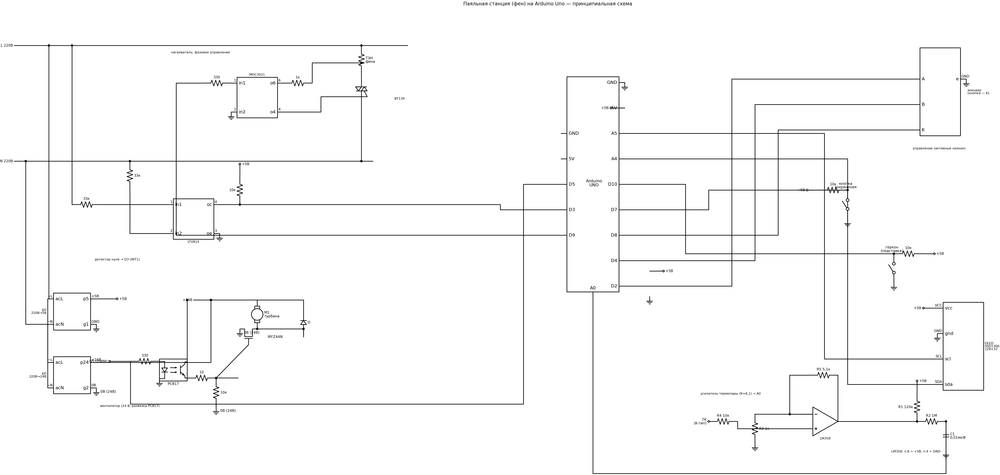

# Паяльный фен (hot air station) на Arduino Uno

Фазовое управление нагревателем через детектор нуля, ПИД-регулирование
температуры, машина состояний (ожидание / нагрев / охлаждение / настройки /
перегрев), графический OLED-дисплей (u8g2, полноэкранный буфер),
кириллица, энкодер с ускорением.

## Экран

```
 Нагрев          ▭▭▭▭▭   350  42%     состояние | шкала мощности | уставка, вентилятор
                ╭─────────────╮
                │     248     │  °C    текущая температура крупно, по центру
                ╰─────────────╯
```

Верхняя строка: состояние слева, мини-шкала мощности нагревателя
(выход ПИД) в середине, справа — подчёркнутая уставка температуры и
цель вентилятора. Правка уставок энкодером отображается мгновенно,
текущие значения обновляются не чаще `TIME_ECHO`. В режиме настроек
по центру крупно показывается выбранный коэффициент P/I/D.

## Основные компоненты

- Arduino Uno (ATmega328P)
- Операционный усилитель LM358P (усилитель термопары, усиление ~6.1)
- Симистор BT139
- Оптопара MOC3021 (драйвер симистора)
- Источники питания 5 В и 24 В
- OLED-дисплей I2C SSD1306 128x32
- Энкодер с кнопкой + кнопка сохранения
- IRFZ44N (MOSFET) для управления скоростью потока воздуха
- LTV814 (2 шт.): детектор перехода через ноль и драйвер MOSFET
  (вторую можно заменить на LTV817)
- Геркон на подставке (фен на подставке — режим ожидания/охлаждения)

## Распиновка

| Пин | Назначение |
|-----|------------|
| D2  | Энкодер, канал A (INT0) |
| D3  | Детектор нуля (INT1) |
| D4  | Энкодер, канал B |
| D5  | ШИМ вентилятора (оптопара + MOSFET) |
| D7  | Кнопка сохранения (активная низкая) |
| D8  | Кнопка энкодера (активная низкая) |
| D9  | Оптосимистор нагревателя (MOC3021) |
| D10 | Геркон подставки (внешняя подтяжка на плате) |
| A0  | Термопара через ОУ LM358 |
| A4/A5 | I2C дисплея |

Все пины и настраиваемые константы собраны в `src/Config.h`.

## Управление

- **Энкодер** — установка температуры или скорости вентилятора
  (с ускорением при быстром вращении).
- **Кнопка энкодера** — переключение, что регулируем: температура / вентилятор.
- **Кнопка сохранения** — запись настроек в EEPROM (уставки + ПИД).
- **Зажать кнопку сохранения при включении** — режим настройки
  коэффициентов ПИД (P/I/D перебираются кнопкой энкодера, применяются
  сразу; выход — снять фен с подставки).
- **Геркон** — фен на подставке: ожидание (< 60 °C) или охлаждение
  вентилятором 100% (>= 60 °C); сняли с подставки — нагрев.
- **Аварийная защита** — при 600 °C (`TEMP_OVERHEAT_OFF`) нагрев
  принудительно выключается, вентилятор на 100%; после остывания
  ниже 80 °C станция возвращается к работе.

## Сборка

Проект переведён на [PlatformIO](https://platformio.org/), достаточно
штатного ядра Arduino AVR (ускоренное ядро GyverCore больше не требуется:
диммер работает на Timer1 в CTC-режиме — два прерывания на полупериод
вместо ~62500 прерываний/с):

```
pio run                 # сборка
pio run -t upload       # прошивка
pio device monitor      # монитор порта (9600)
```

Библиотеки ставятся автоматически (u8g2, Arduino-PID-Library).
Отладка по UART включается раскомментированием `DEBUG_SERIAL` /
`DEBUG_PID_SERIAL` в `src/Config.h`.

Язык подписей на дисплее переключается в `src/Lang.h` (`LANG_ENG`).

Настройки хранятся в EEPROM одним блоком с контрольной суммой;
при первой прошивке версии 1.5.0 значения переносятся из старого
формата 1.4.x автоматически.

## Структура проекта

```
src/
├── main.cpp          # setup/loop
├── Config.h          # пины, константы, отладка
├── Lang.h, rus.h, eng.h   # локализация (обычный UTF-8, шрифт u8g2 с кириллицей)
├── Dimmer            # Timer1 (CTC) + детектор нуля, фазовое управление
├── Fan               # ШИМ вентилятора
├── Thermocouple      # оверсэмплинг 64x + линеаризация
├── Input             # энкодер, кнопки, геркон
├── Display           # u8g2, полноэкранный буфер (512 байт ОЗУ)
├── SettingsStore     # EEPROM (структура + checksum + миграция)
├── State + *State    # машина состояний (ожидание/нагрев/охлаждение/
│                     #  настройки/перегрев)
└── Thermofan         # координатор: ПИД + модули + состояния
```

Диммер рассчитан на сеть 50 Гц (500 единиц по 16 мкс = 8 мс —
полупериод); для 60 Гц требуется уменьшить `WARMTICK` в `Config.h`.
Плата разведена в Sprint Layout: `фен.lay6`.

## Используемые библиотеки

- u8g2 (дисплей): https://github.com/olikraus/u8g2
- Arduino PID Library: https://playground.arduino.cc/Code/PIDLibrary/

## Полезная информация

- Настройка коэффициентов ПИД-регулятора:
  http://lazysmart.ru/osnovy-avtomatiki/nastrojka-pid-regulyatora/
- Дискретный регулятор мощности (теория фазового управления):
  https://www.qrz.ru/schemes/contribute/digest/bp169.shtml

## В собранном виде


Для правильной регулировки написана программа на C#, показывающая график:
https://github.com/Igor-kor/ArduinoDiagramm
- Пример


## Принципиальная схема

Полная схема станции (номиналы соответствуют узловым схемам ниже).
Генерируется скриптом: `python tools/make_schematic.py`
(результат — `img/schematic.png` и `.svg`).



Кратко по узлам:

- **Нагреватель** — фазовое управление: MOC3021 (вход — 330 Ом от D9,
  выход — 1к на MT2) открывает симистор BT139 в рассчитанной фазе
  полупериода; Timer1 (CTC) отсчитывает задержку от перехода через ноль.
- **Детектор нуля** — LTV814, два 33 кОм от сети, выход с подтяжкой
  10 кОм на D3 (INT1).
- **Вентилятор** — ШИМ D5 → PC817 → затвор IRFZ44N (10 Ом в затворе,
  подтяжка 10 кОм), турбина 24 В с диодом обратного хода; сторона 24 В
  гальванически развязана с Arduino.
- **Термопара** — неинвертирующий усилитель на LM358 (К≈6,1: R3 1к /
  R5 5,1к), смещение R1 120к от +5В, фильтр R2 1М + C1 0,01мкФ → A0.
- **Питание** — два импульсных БП: 5 В (Arduino, дисплей, LM358) и
  24 В (турбина), земли развязаны.

## Узловые схемы (оригиналы)

- Определение перехода через ноль

- Управление турбиной фена

- Усилитель для термопары


## История изменений

### 1.5.0 — рефакторинг

**Сборка и структура**
- Проект переведён на PlatformIO (`pio run` / `pio run -t upload`);
  достаточно штатного ядра Arduino AVR — GyverCore больше не нужен.
- Класс Thermofan разбит на модули: Dimmer, Fan, Thermocouple, Input,
  Display, SettingsStore; состояния переведены на синглтоны.

**Исправленные дефекты**
- volatile и атомарный доступ к переменным, общим с прерываниями
  (раньше 16-битные чтения/записи могли разрываться посреди ISR).
- Timer2 включался битом CS10 таймера 1 (совпадение по значению) — CS20.
- Коэффициенты ПИД из режима настроек теперь применяются сразу
  (SetTunings), а не после перезагрузки.
- EEPROM писался в каждом цикле, пока зажата кнопка сохранения —
  теперь один раз по нажатию.
- ПИД считался до чтения датчиков — теперь после (свежая температура).
- Serial.print из прерываний, отсутствие виртуального деструктора State,
  переполнение millis() в энкодере, затирание метки «%» на дисплее.

**Новые возможности и улучшения**
- Аварийная защита от перегрева: при 600 °C нагрев принудительно
  выключается, вентилятор на 100%; возврат к работе после остывания
  ниже 80 °C.
- Диммер переведён на 16-битный Timer1 (CTC): ~200 прерываний/с вместо
  ~62500; при пропадании детектора нуля нагрев остаётся выключенным.
- Графический интерфейс на u8g2: текущая температура крупно по центру,
  шкала мощности, экран настройки ПИД; кириллица — обычный UTF-8.
- Настройки хранятся в EEPROM одним блоком (magic + контрольная сумма),
  значения из формата 1.4.4 переносятся автоматически.
- Принципиальная схема (`img/schematic.png`) и скрипт-генератор
  `tools/make_schematic.py`.

### 1.4.4 и ранее

- Настройка ПИД (зажать кнопку сохранения при включении), версионирование
  EEPROM, диммер на счётчике переполнений Timer2, локализация rus/eng,
  машина состояний на паттерне State. См. историю коммитов.
