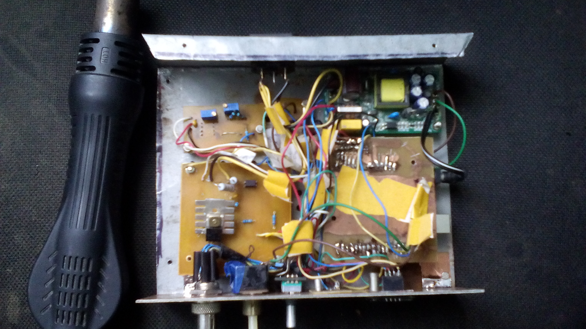
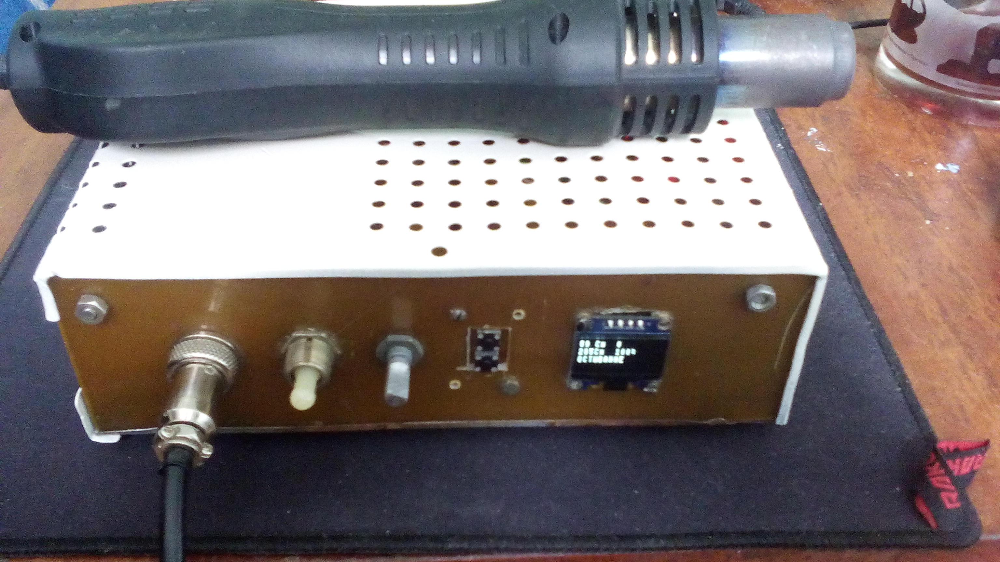
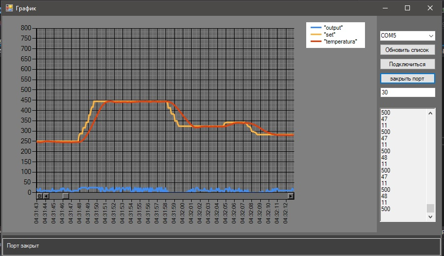
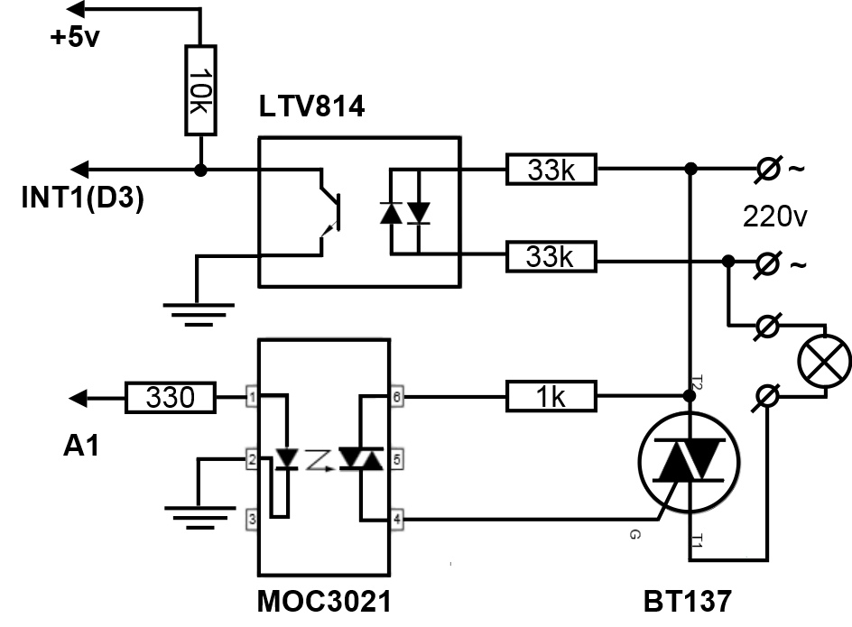
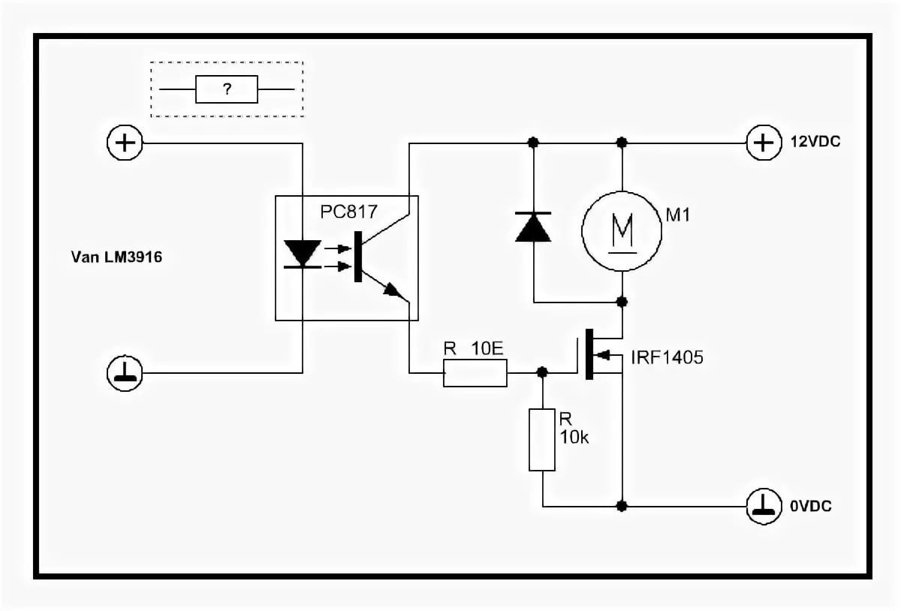
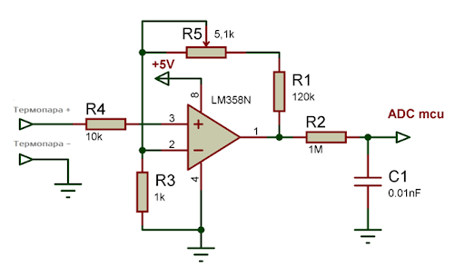

# Паяльный фен (hot air station) на Arduino Uno

Фазовое управление нагревателем через детектор нуля, ПИД-регулирование
температуры, машина состояний (ожидание / нагрев / охлаждение / настройки),
OLED-дисплей с кириллицей, энкодер с ускорением.

## Основные компоненты

- Arduino Uno (ATmega328P)
- Операционный усилитель LM358P (усилитель термопары, усиление ~6.1)
- Симистор BT139
- Оптопара MOC3021 (драйвер симистора)
- Источники питания 5 В и 24 В
- OLED-дисплей I2C SSD1306 128x32
- Энкодер с кнопкой + кнопка сохранения
- IRFZ44N (MOSFET) для управления скоростью потока воздуха
- LTV814 (2 шт.): детектор перехода через ноль и драйвер MOSFET
  (вторую можно заменить на LTV817)
- Геркон на подставке (фен на подставке — режим ожидания/охлаждения)

## Распиновка

| Пин | Назначение |
|-----|------------|
| D2  | Энкодер, канал A (INT0) |
| D3  | Детектор нуля (INT1) |
| D4  | Энкодер, канал B |
| D5  | ШИМ вентилятора (оптопара + MOSFET) |
| D7  | Кнопка сохранения (активная низкая) |
| D8  | Кнопка энкодера (активная низкая) |
| D9  | Оптосимистор нагревателя (MOC3021) |
| D10 | Геркон подставки (внешняя подтяжка на плате) |
| A0  | Термопара через ОУ LM358 |
| A4/A5 | I2C дисплея |

Все пины и настраиваемые константы собраны в `src/Config.h`.

## Управление

- **Энкодер** — установка температуры или скорости вентилятора
  (с ускорением при быстром вращении).
- **Кнопка энкодера** — переключение, что регулируем: температура / вентилятор.
- **Кнопка сохранения** — запись настроек в EEPROM (уставки + ПИД).
- **Зажать кнопку сохранения при включении** — режим настройки
  коэффициентов ПИД (P/I/D перебираются кнопкой энкодера, применяются
  сразу; выход — снять фен с подставки).
- **Геркон** — фен на подставке: ожидание (< 60 °C) или охлаждение
  вентилятором 100% (>= 60 °C); сняли с подставки — нагрев.
- **Аварийная защита** — при 600 °C (`TEMP_OVERHEAT_OFF`) нагрев
  принудительно выключается, вентилятор на 100%; после остывания
  ниже 80 °C станция возвращается к работе.

## Сборка

Проект переведён на [PlatformIO](https://platformio.org/), достаточно
штатного ядра Arduino AVR (ускоренное ядро GyverCore больше не требуется:
диммер работает на Timer1 в CTC-режиме — два прерывания на полупериод
вместо ~62500 прерываний/с):

```
pio run                 # сборка
pio run -t upload       # прошивка
pio device monitor      # монитор порта (9600)
```

Библиотеки ставятся автоматически (u8g2, Arduino-PID-Library).
Отладка по UART включается раскомментированием `DEBUG_SERIAL` /
`DEBUG_PID_SERIAL` в `src/Config.h`.

Язык подписей на дисплее переключается в `src/Lang.h` (`LANG_ENG`).

Настройки хранятся в EEPROM одним блоком с контрольной суммой;
при первой прошивке версии 1.5.0 значения переносятся из старого
формата 1.4.x автоматически.

## Структура проекта

```
src/
├── main.cpp          # setup/loop
├── Config.h          # пины, константы, отладка
├── Lang.h, rus.h, eng.h, u8x8_font_ikor.h  # локализация и шрифт
├── Dimmer            # Timer1 (CTC) + детектор нуля, фазовое управление
├── Fan               # ШИМ вентилятора
├── Thermocouple      # оверсэмплинг 64x + линеаризация
├── Input             # энкодер, кнопки, геркон
├── Display           # обёртка u8x8
├── SettingsStore     # EEPROM (структура + checksum + миграция)
├── State + *State    # машина состояний (ожидание/нагрев/охлаждение/
│                     #  настройки/перегрев)
└── Thermofan         # координатор: ПИД + модули + состояния
```

Диммер рассчитан на сеть 50 Гц (500 единиц по 16 мкс = 8 мс —
полупериод); для 60 Гц требуется уменьшить `WARMTICK` в `Config.h`.
Плата разведена в Sprint Layout: `фен.lay6`.

## Используемые библиотеки

- u8g2 (дисплей): https://github.com/olikraus/u8g2
- Arduino PID Library: https://playground.arduino.cc/Code/PIDLibrary/

## Полезная информация

- Настройка коэффициентов ПИД-регулятора:
  http://lazysmart.ru/osnovy-avtomatiki/nastrojka-pid-regulyatora/
- Дискретный регулятор мощности (теория фазового управления):
  https://www.qrz.ru/schemes/contribute/digest/bp169.shtml

## В собранном виде




Для правильной регулировки написана программа на C#, показывающая график:
https://github.com/Igor-kor/ArduinoDiagramm
- Пример


## Схемы

- Определение перехода через ноль

- Управление турбиной фена

- Усилитель для термопары

